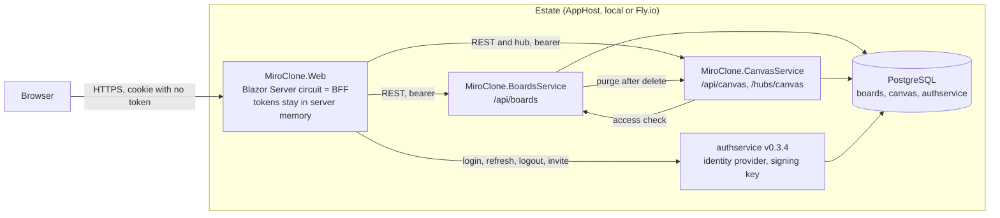

# miro-clone

A Miro-style collaborative whiteboard. Sign in, keep boards on a workspace dashboard, and draw and co-edit on a canvas
with live cursors and presence. It is a .NET 10 rebuild of the Next.js/Convex/Liveblocks original, built to the estate's
architecture standards.

**Status (2026-10-26):** the product features of WP02–WP11 are merged to `main`. The end-to-end browser suite (WP12) is not
merged yet, and nothing has been deployed: Fly.io deployment is disabled by owner decision ([ADR 0026](docs/decisions/0026-fly-deployment-disabled-by-owner.md)).
What is verified and what is not is listed in [`docs/TESTING.md`](docs/TESTING.md) and [`docs/architecture/COMPLIANCE.md`](docs/architecture/COMPLIANCE.md).

## What it does

- **Accounts** through authservice, the only identity provider: sign up, verify email, sign in, sign out, forgot and reset
  password, and accept updated terms at sign-in. Two-factor sign-in is refused with a message.
- **Dashboard** for the workspace (one authservice organization): list boards, search, favourites, create, rename, delete,
  and invite members (Owner and Admin). List state lives in the address, so a link reopens the same view.
- **Board canvas:** select, move, resize, multi-select, rectangle, ellipse, text, note, pencil path, eight-colour palette,
  bring to front and back, delete, undo and redo, and keyboard shortcuts. Text and notes edit in place.
- **Live co-editing:** edits go to the canvas service over a SignalR hub as they happen. Participants and their cursors
  and selections are shown, once per person, and a banner says when the connection is lost.
- **Persistence:** a board's layers are snapshotted to PostgreSQL about every two seconds and reloaded after a restart.

Not in scope, by [ADR 0004](docs/decisions/0004-scope-excludes-agents-chat-and-simulation.md): AI agents, chat,
simulations, metrics and templates. Known gaps and the ranked backlog are in [`docs/UI-UX.md`](docs/UI-UX.md).

## Architecture at a glance



Each service validates the same RS256 token against authservice's JWKS and holds no signing key. Details, sequences and the
data each store holds are in [`docs/ARCHITECTURE.md`](docs/ARCHITECTURE.md).

## Prerequisites

- .NET SDK 10. The SDK is pinned in [`global.json`](global.json) (10.0.100, roll-forward to the latest feature band).
- **Docker** running locally. The AppHost starts PostgreSQL and authservice as containers.
- `openssl`, to create the development signing key ([`docs/AUTH.md`](docs/AUTH.md)).
- Git hooks, recommended: `scripts/install-hooks.sh`, then [gitleaks](https://github.com/gitleaks/gitleaks#installing).
  The pre-commit hook refuses to commit without gitleaks.

## Run it locally

1. Clone once and install the hooks:

   ```bash
   scripts/install-hooks.sh
   ```

2. Create the RS256 development key outside the repository and store it as a user secret. The AppHost reads it at start-up.
   The full steps are in [`docs/AUTH.md`](docs/AUTH.md#running-it-in-development).

   ```bash
   openssl genpkey -algorithm RSA -pkeyopt rsa_keygen_bits:2048 -out ~/miroclone-jwt-dev.pem
   dotnet user-secrets set "Parameters:authservice-jwt-private-key" "$(cat ~/miroclone-jwt-dev.pem)" --project MiroClone.AppHost
   ```

3. Start the estate through the Aspire AppHost. It starts PostgreSQL, authservice, the two services and the web app, and
   opens the Aspire dashboard. The first run downloads the Aspire orchestration packages.

   ```bash
   scripts/run-local-stack.sh
   ```

4. Open the web app from the dashboard. Sign up at `/sign-up` for a new account. A new account has no workspace until an
   organization exists in authservice, so for two users with a shared workspace run the seed script with the authservice
   address from the dashboard:

   ```bash
   scripts/seed-dev-users.sh http://localhost:<authservice-port>
   ```

   The seed script creates `owner@dev.test` and `member@dev.test`. The member's invitation token is printed to the
   authservice log on the first run; the script says where to find it. See [`docs/AUTH.md`](docs/AUTH.md).

The development configuration is in `MiroClone.AppHost/EstateExtensions.cs`. It relaxes two settings that deployments do not
(`Auth__RequireHttpsMetadata=false` and `ASPNETCORE_ENVIRONMENT=Development`, so authservice logs its dev outbox).

## Build and test

```bash
dotnet restore MiroClone.sln
dotnet build MiroClone.sln
dotnet test --solution MiroClone.sln
```

`dotnet test --solution MiroClone.sln` is the form the local SDK (10.0.113) accepted in the WP10 run. The PostgreSQL tests run
only when `TEST_POSTGRES` names a reachable server. They are skipped otherwise. See [`docs/TESTING.md`](docs/TESTING.md).

## Repository layout

| Path | What it is |
|---|---|
| `MiroClone.AppHost` | Aspire composition root for local development: PostgreSQL, authservice, the services and the web app |
| `MiroClone.ServiceDefaults` | Shared kernel: telemetry, health, resilience, JWT validation, rate limits, origin guard. Capped at 800 lines |
| `MiroClone.BoardsService` | Boards and favourites. Own database `boards`. EF Core migrations |
| `MiroClone.CanvasService` | Canvas per board: in-memory aggregate, JSON snapshot in `canvas`, SignalR hub `/hubs/canvas` |
| `MiroClone.Web` | Blazor Web App, interactive Server. The backend-for-frontend. Canvas rules are in `Canvas/Core` |
| `tests/` | One xUnit project per service, `Web.Tests` (bUnit), `TestSupport` (token factory and local authority stand-in) |
| `docs/` | Plan, decisions, auth, deployment, architecture, UI, testing and privacy |
| `flyio/` | Fly.io configuration for the five apps. Not deployed (ADR 0026) |
| `scripts/` | Local stack, dev user seeding, hooks, kernel size guard, Fly preview database helper |
| `.github/workflows/` | `pr-validation` (build, test, Docker build), `secret-scan` (gitleaks), and the disabled Fly workflows |

[`AGENTS.md`](AGENTS.md) has the full layout table and the rules that are easy to break.

## Documentation

- [`docs/ARCHITECTURE.md`](docs/ARCHITECTURE.md): topology, auth and BFF flow, realtime flow, data ownership
- [`docs/UI-UX.md`](docs/UI-UX.md): screens, states, ranked backlog and the known gaps
- [`docs/TESTING.md`](docs/TESTING.md): what each test layer proves, what runs in CI, what has never run
- [`docs/PRIVACY.md`](docs/PRIVACY.md): personal data held, and what happens to authorship when a user is erased
- [`docs/architecture/COMPLIANCE.md`](docs/architecture/COMPLIANCE.md): the reference-architecture checklist with evidence and the open register
- [`docs/AUTH.md`](docs/AUTH.md): claims, token rules, development sign-in
- [`docs/DEPLOYMENT.md`](docs/DEPLOYMENT.md): Fly.io topology and owner steps (deployment disabled, ADR 0026)
- [`docs/implementation-plan/`](docs/implementation-plan/README.md): the work packages, frozen contracts and sub-session protocol

## Decisions

Architecture decision records live in [`docs/decisions/`](docs/decisions/). The file name is the number. Two files carry the
number 0011, and some headings disagree with their file names; the file name is the reference (see the register in
[`COMPLIANCE.md`](docs/architecture/COMPLIANCE.md#3a-open-register)).

| ADR | Topic |
|---|---|
| [0001](docs/decisions/0001-blazor-web-app-over-nextjs.md) | Blazor Web App over Next.js |
| [0002](docs/decisions/0002-authservice-as-only-identity-provider.md) | authservice is the only identity provider |
| [0003](docs/decisions/0003-service-and-database-per-context.md) | One service and database per context |
| [0004](docs/decisions/0004-scope-excludes-agents-chat-and-simulation.md) | Scope excludes agents, chat and simulation |
| [0005](docs/decisions/0005-servicedefaults-kernel-scope.md) | ServiceDefaults holds plumbing only, under a ceiling |
| [0006](docs/decisions/0006-origin-guard-is-a-mitigation-not-authentication.md) | The origin guard is a mitigation, not authentication |
| [0007](docs/decisions/0007-jwt-validation-and-workspace-claim.md) | JWT validation against JWKS (amended by 0011) |
| [0008](docs/decisions/0008-aspire-apphost-sdk-and-endpoints.md) | The Aspire AppHost SDK and explicit endpoints |
| [0009](docs/decisions/0009-migrate-on-startup-in-the-kernel.md) | Migration on startup, before the host listens |
| [0010](docs/decisions/0010-generated-migrations-excluded-from-style-rules.md) | EF Core migration files are generated code |
| [0011](docs/decisions/0011-authservice-adoption-and-token-contract.md) | authservice as a pinned image; one audience; `organization` claim |
| [0011](docs/decisions/0011-canvas-core-in-the-web-assembly.md) | Canvas rules in `Canvas/Core` (duplicate number) |
| [0012](docs/decisions/0012-canvas-core-rules-and-layer-order.md) | Layer order, net selection, resize, history |
| [0013](docs/decisions/0013-canvas-purge-is-best-effort-and-in-request.md) | Canvas purge after delete is best effort |
| [0014](docs/decisions/0014-boards-list-validation-and-test-database-interpretations.md) | Boards list, validation and test database |
| [0015](docs/decisions/0015-canvas-snapshot-store-idempotent-ddl.md) | Canvas snapshot: write-behind JSON, idempotent DDL |
| [0016](docs/decisions/0016-realtime-hub-membership-and-token-transport.md) | Hub membership on every join; token transport; purge by ownership |
| [0017](docs/decisions/0017-fly-estate-topology-and-consumed-authservice.md) | Fly.io estate topology (not deployed) |
| [0018](docs/decisions/0018-forwarded-headers-before-the-origin-guard.md) | Forwarded headers before the origin guard |
| [0019](docs/decisions/0019-web-data-protection-keys-on-a-volume.md) | Web Data Protection keys on a volume, one machine |
| [0020](docs/decisions/0020-data-services-run-one-machine-and-deploy-immediately.md) | Migrating services run one machine |
| [0021](docs/decisions/0021-preview-environments-per-pr-databases-and-keys.md) | Preview environments (not deployed) |
| [0022](docs/decisions/0022-web-sign-in-is-a-backend-for-frontend-with-server-side-sessions.md) | Sign-in as a BFF with server-side sessions |
| [0023](docs/decisions/0023-session-refresh-is-single-flight-and-a-refused-refresh-ends-the-session.md) | Single-flight refresh; a refused refresh ends the session |
| [0024](docs/decisions/0024-the-workspace-is-the-single-organization-in-the-token-and-a-choice-waits-for-authservice.md) | The workspace is the single organization; a choice waits for authservice |
| [0025](docs/decisions/0025-account-lifecycle-through-authservice-verification-consent-and-reset.md) | Account lifecycle through authservice; consent at sign-in |
| [0026](docs/decisions/0026-fly-deployment-disabled-by-owner.md) | Fly.io deployment disabled by owner decision |
| [0027](docs/decisions/0027-dashboard-state-in-the-address-and-deviations-from-the-reference.md) | Dashboard state in the address; deviations from the reference |
| [0028](docs/decisions/0028-board-covers-are-token-coloured-svg-and-the-dashboard-has-no-javascript.md) | Board covers are token-coloured SVG; no dashboard JavaScript |
| [0030](docs/decisions/0030-one-es-module-for-board-pointer-input.md) | One ES module (60 lines) for pointer input |
| [0031](docs/decisions/0031-board-edits-are-local-until-the-hub-lands-and-gestures-commit-once.md) | Edits through `ICanvasSession`; one gesture, one undo step |
| [0032](docs/decisions/0032-board-title-by-walking-the-list-until-a-single-read-is-frozen.md) | Board title by walking the list |
| [0033](docs/decisions/0033-board-editing-keys-palette-and-in-place-text.md) | Editing keys, palette and in-place text |
| [0034](docs/decisions/0034-dashboard-closes-the-new-board-and-focus-gaps-without-javascript.md) | Create opens the board; focus return and trap |
| [0035](docs/decisions/0035-live-board-session-is-a-circuit-owned-hub-client.md) | The live session is a circuit-owned hub client |
| [0036](docs/decisions/0036-presence-keyed-by-connection-shown-once-per-user.md) | Presence keyed by connection, shown once per user |
| [0037](docs/decisions/0037-circuit-hub-client-uses-http-transports-through-service-discovery.md) | The circuit's hub client uses SSE and long polling |
| [0038](docs/decisions/0038-compliance-register-and-verification-boundary.md) | Compliance evidence and the open register |

There is no ADR 0029 in the repository.

## Licence

Not yet chosen. This repository has never contained a LICENSE file; the owner decides.
