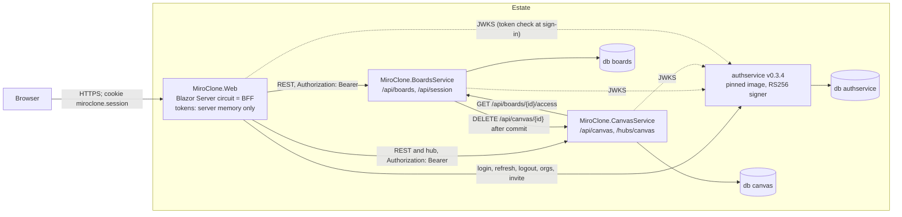

# Architecture

As of 2026-10-26, from the code on `main` (WP10 merged). Where a decision is the reason for a shape, the ADR is named. Where the
code and an older ADR disagree, the code is stated here and the ADR is named as stale.

## 1. Topology

Only the web app is reachable from a browser. Every other service is reached by name inside the estate (AppHost service
discovery locally, Fly private networking if it is ever deployed). The AppHost wiring is in `MiroClone.AppHost/EstateExtensions.cs`.



| Piece | Project or image | Process | Public? |
|---|---|---|---|
| Web (BFF) | `MiroClone.Web` | Kestrel on 8080 | Yes (`WithExternalHttpEndpoints`) |
| Boards | `MiroClone.BoardsService` | Kestrel on 8080 | No |
| Canvas | `MiroClone.CanvasService` | Kestrel on 8080 | No |
| authservice | `ghcr.io/konradcinkusz/authservice:v0.3.4` | container | No |
| PostgreSQL | `postgres` container with three databases | container | No |

A database belongs to one service and no other service connects to it (ADR 0003). Cross-service reads are HTTP, behind
anti-corruption clients: `BoardsAccessClient` in CanvasService and `CanvasPurgeClient` in BoardsService.

## 2. Authentication and the BFF

The browser never holds a token. The circuit holds the access and refresh tokens in a server-side session, and the
browser holds a cookie that names the session (ADR 0022).

```mermaid
sequenceDiagram
  autonumber
  participant B as Browser
  participant W as Web (BFF)
  participant A as authservice
  participant S as BoardsService
  B->>W: POST /account/sign-in (antiforgery token, email, password)
  W->>A: POST /api/v1/auth/login
  A-->>W: access token + refresh token (RS256, aud miro-clone)
  W->>W: AccessTokenValidator: signature from JWKS, iss, aud, lifetime
  W->>W: SessionService stores tokens in IDistributedCache (memory), keyed by session id
  W-->>B: Set-Cookie miroclone.session (sub, email, email_verified, session id; no token)
  B->>W: GET / (circuit opens)
  W->>W: SessionRevalidatingAuthenticationStateProvider checks the session every 5 min
  W->>S: GET /api/boards (Bearer, read from the session per request)
  S->>S: JWT validation against JWKS; WorkspaceClaims: exactly one organization claim
  S-->>W: BoardPage
  W-->>B: rendered over the circuit
```

Rules that hold in the code:

- **Cookie:** `miroclone.session`, HttpOnly, SameSite=Strict, Secure outside Development (`MiroClone.Web/ServiceCollectionExtensions.cs`).
  It carries no token. Its claims are `sub`, `email`, `email_verified` and the session id (`Auth/SessionClaims.cs`).
- **Refresh** is single-flight per session: a striped lock, then the stored token is re-read (ADR 0023). A 400 or 401 from
  authservice ends the session. An outage keeps it.
- **Session lifetime** is absolute: eight hours (`Session:Lifetime`). Refresh extends the tokens, not the session.
- **Sessions do not survive a restart or a second instance.** The distributed cache is `AddDistributedMemoryCache()`. The
  estate runs one web instance (ADR 0022, ADR 0019).
- **Workspace:** the workspace is read from the stored access token, not the cookie. One `organization` claim is the active
  workspace. Two or more is "choose one", and none is "no workspace" (`Auth/WorkspaceState.cs`, ADR 0024). The dashboard
  calls no boards endpoint unless a workspace is active.
- **Origin guard** runs first on every service and on the Web app (ADR 0006, ADR 0018). It refuses a foreign `Origin` and
  a cross-site request. It is a mitigation, not authentication.

### Token rules, all services

| Rule | Value | Where |
|---|---|---|
| Algorithm | RS256 only | `ServiceDefaults/AuthenticationExtensions.cs` (`ValidAlgorithms`) |
| Keys | authservice discovery and JWKS; no key in any service | same |
| Issuer | `MiroClone` | `EstateExtensions.TokenIssuer` |
| Audience | `miro-clone` (one for the estate) | `EstateExtensions.TokenAudience`; ADR 0011 amends ADR 0007 |
| Clock skew | 30 s, capped at 5 min | `AuthenticationExtensions.cs` |
| Claim names | `MapInboundClaims = false`; `sub` and `organization` | ADR 0011 |

### Development sign-in (AppHost)

The AppHost gives authservice the RS256 private key as a secret parameter (`authservice-jwt-private-key`, from user
secrets). No key lives in the repository. `docs/AUTH.md` has the commands.

## 3. Realtime: the canvas session

The browser never connects to the canvas hub. The circuit does, using the session's token, and it pushes the results to the
page over the circuit's own connection (ADR 0035). The only JavaScript is one ES module that forwards pointer and wheel
input (`wwwroot/js/canvas-pointer.js`, ADR 0030).

```mermaid
sequenceDiagram
  autonumber
  participant B as Browser
  participant P as Board page (circuit)
  participant H as HubCanvasSession
  participant C as CanvasService
  participant S as BoardsService
  participant O as Other circuit
  B->>P: open /board/{id}
  P->>C: GET /api/canvas/{id} (Bearer)
  C->>S: GET /api/boards/{id}/access (Bearer forwarded, no redirects)
  S-->>C: 204, or 404 for a board not in the workspace
  C-->>P: CanvasState (or 404, shown as "Board not found")
  P->>H: Start() (once per open board)
  H->>C: connect /hubs/canvas over SSE or long polling (Authorization header)
  H->>C: JoinBoard(id)
  C->>S: access check again (membership on every join, ADR 0016)
  C-->>H: InitialState(CanvasState, Presence[])
  B->>P: pointer gesture (canvas-pointer.js, then BoardEditor)
  P->>H: Commit: History.Execute, then outbox
  H->>C: SendMutation(boardId, LayerMutation), one at a time, in order
  C->>C: BoardCanvas applies it; the board is marked dirty
  C-->>O: LayerMutation(connectionId, mutation) to the others in the group
  O->>O: MutationApplier on the circuit's ComponentDispatcher
  C->>C: CanvasSnapshotWriter flushes dirty boards every 2 s
```

Notes:

- **Presence** is sent at most 20 times a second (50 ms pacing). Identity (user id, label, colour) is stamped by the server
  from the token, never from the client (`Realtime/CanvasHub.cs`, `Stamp`). The label is `Member` plus four hex digits of the
  user id, because authservice issues no name claim.
- **Rate limits** are per connection, with no queue: mutations 120 in a burst, refilling at 60 a second; presence 60 in a
  burst, refilling at 30 a second (ADR 0016 §6).
- **Layer order** is bottom to top in `layerIds` and in `order` (ADR 0012). The limit is 100 layers per board (`LayerRules.MaxLayers`).
- **Reconnect:** the session re-reads the board, replays its unsent edits on top, and keeps retrying with backoff from one to
  15 seconds. A terminal refusal (not visible, or no sign-in) stops the retries (ADR 0035).
- **Message size** cap is 128 KB, so a 2,000-point stroke is accepted (ADR 0016 §7).

### Delete a board

```mermaid
sequenceDiagram
  autonumber
  participant W as Web (dashboard)
  participant S as BoardsService
  participant C as CanvasService
  W->>S: DELETE /api/boards/{id} (Bearer)
  S->>S: remove favourites and board, one SaveChanges
  S-->>W: 204 (committed)
  S->>C: DELETE /api/canvas/{id} (Bearer forwarded, 8 s timeout)
  alt snapshot exists and the caller's workspace owns it
    C-->>S: 204, snapshot purged
  else no snapshot
    C-->>S: 204, nothing to do
  else another workspace owns it, or no single organization
    C-->>S: 404, refused without revealing anything
  else unreachable or error
    S->>S: logged; the delete stays committed
  end
```

A purge that fails leaves an orphan snapshot. No code removes orphans yet: the log message says "left for the sweep" and
ADR 0013 describes a sweep, but no sweep exists in the repository (see [`COMPLIANCE.md`](architecture/COMPLIANCE.md#open-register)).

## 4. Persistence and data ownership

| Store | Owner | What it holds | Written when |
|---|---|---|---|
| `boards.boards` | BoardsService | id, workspace id, title, title search key, author id, author name, image seed, created time | create, rename, delete |
| `boards.board_favourites` | BoardsService | user id, board id | favourite toggle; deleted with the board |
| `canvas.canvas_snapshots` | CanvasService | board id, workspace id, version, updated time, layers as JSON | every 2 s for a dirty board; deleted by purge |
| `authservice` database | authservice (not this repo) | users, organizations, memberships, consents, refresh tokens | authservice |
| Canvas memory | CanvasService | live aggregate per loaded board (up to 1,000 at start-up), presence | edits, joins, leaves |
| Web memory | Web | session tokens and claims (`IDistributedCache`, memory) | sign-in, refresh, sign-out |
| `App_Data/keys` or `/data/keys` | Web | ASP.NET Data Protection key ring (`DataProtection:KeysPath`) | first start |

Schema is applied on start-up, before the host listens (ADR 0009). Boards uses EF Core migrations. Canvas stores its snapshot
table with idempotent hand-written DDL and no ORM model, which ADR 0015 records as a deliberate choice; its EF migration is empty.

Cross-cutting facts: a crash loses at most two seconds of canvas edits (ADR 0015). A canvas at the caps is about 4 MB of JSON
per flush. A Web restart ends every session and every open circuit.

## 5. Decisions by topic

| Topic | ADRs |
|---|---|
| Shape of the estate and identity | 0001, 0002, 0003, 0004, 0011 |
| Kernel and platform wiring | 0005, 0006, 0008, 0009, 0010, 0018 |
| Tokens and claims | 0007 (amended by 0011), 0024 |
| Web sessions and account flows | 0019, 0022, 0023, 0025 |
| Canvas rules and persistence | 0012, 0013, 0015, 0016, 0031, 0033 |
| Realtime | 0016, 0035, 0036, 0037 |
| Dashboard | 0014, 0027, 0028, 0032, 0034 |
| Browser code budget | 0030, 0028 |
| Deployment (disabled) | 0017, 0019, 0020, 0021, 0026 |
| Process and records | 0038 |

ADR file numbers are the reference. ADR 0011 exists twice (authservice adoption; canvas core), and some ADR headings show
another number. [`COMPLIANCE.md`](architecture/COMPLIANCE.md#open-register) lists them.

## 6. Components inside the Web app

| Folder | Role |
|---|---|
| `Account/`, `Components/Pages/Account/` | Static account forms and their minimal endpoints under `/account/*` (ADR 0022) |
| `Auth/` | Sessions, refresh, token validation, workspace state, authority client |
| `Api/` | Typed clients for boards and canvas, with the session passed per call |
| `Canvas/Core/` | Plain C# rules: geometry, hit testing, resize, history, mutations, palette. No Blazor types (`CoreIsolationTests`) |
| `Canvas/Editing/` | `ICanvasSession` and the local implementation |
| `Canvas/Interaction/` | `BoardEditor`: tools, gestures, selection, keys |
| `Canvas/Realtime/` | `HubCanvasSession`, hub connection, wire mapping, dispatcher |
| `Canvas/Interop/` | The one JavaScript module, through `ICanvasPointerSource` |
| `Components/` | Razor components: dashboard, board, layout, shared |
